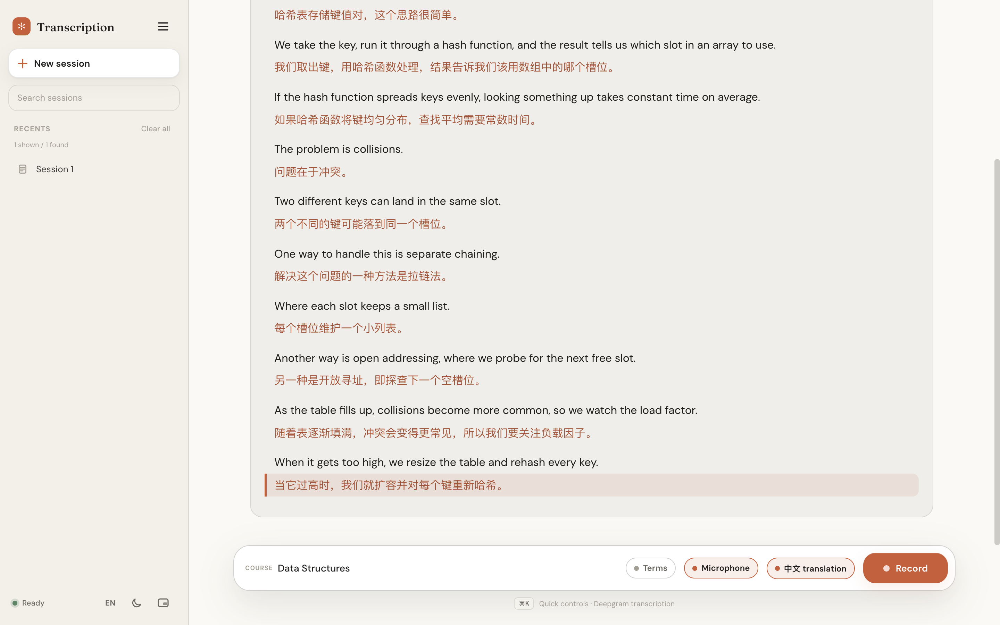

# Live Lecture Captions (HAHAHAv2)

**Real-time English lecture captions with a Chinese translation under every sentence.**

I built this for myself as an international student: during a lecture I open it in Chrome, and
what the lecturer says appears as live English text, with a Chinese line following each sentence a
moment later. It runs locally as a small web app and uses two cloud APIs: Deepgram for
speech-to-text and DeepSeek for translation.



<sub>A short sample lecture (macOS text-to-speech) run through the real pipeline: Deepgram transcription,
DeepSeek translation. Dark theme: [docs/screenshot-dark.png](docs/screenshot-dark.png).</sub>

<!-- A short demo GIF will go here: docs/demo.gif -->

## Features

- **Live transcription**: Deepgram `nova-3` streaming, English.
- **Sentence-by-sentence translation**: each English sentence gets its own Chinese line. Sentences
  that are already complete in the interim transcript are translated early, so the Chinese shows up
  sooner. Translation can be switched off.
- **Two audio sources**: the microphone, or computer audio (shared through Chrome) for online
  lectures and recordings.
- **Doesn't lose words when the connection drops**: if Deepgram disconnects, the network goes down,
  the browser loses its connection, or the backend restarts, up to 10 minutes of audio is buffered
  and transcribed afterwards.
- **Course terms**: each course keeps its own list of terms. Terms are learned after every
  recording, can be edited by hand, or imported from lecture slides (PDF/text). They are passed to
  Deepgram (so it hears them correctly) and to the translator (so they're translated consistently).
- **History & export**: sessions are saved to a local SQLite file. Export produces an
  English/Chinese Markdown file.
- **API balances**: the sidebar shows the remaining Deepgram and DeepSeek balance.
- **Mini window**: a compact view showing the last two sentences.
- Light/dark themes, English/Chinese interface.

## How it works

```
Browser (index.html)                     Backend (backend.py, FastAPI)           Cloud
───────────────────                      ─────────────────────────────           ─────
AudioWorklet → 16 kHz PCM
  100 ms chunks, numbered  ──/ws-stt──▶  STTSession ──────── stream ──────────▶ Deepgram
  outbox keeps every chunk               (one per recording)  ◀── words ────────
  until it is acknowledged ◀── ack ───   LiveTranslator ───── per sentence ───▶ DeepSeek
                           ◀── text ──   (splits into sentences) ◀── Chinese ──
```

The interesting part is not losing audio:

- The backend acknowledges a chunk only once its audio has been **finalized** by Deepgram, not just
  received. The browser keeps everything un-acknowledged, so even if the backend process is killed
  and restarted, the browser resends what was not yet transcribed.
- When the Deepgram stream reconnects, it restarts **3 seconds before** the last finalized point and
  drops duplicate words by timestamp. Restarting at the exact point was tested and lost the first word.
- If more than 3 seconds of audio has piled up, the backlog goes through Deepgram's pre-recorded API
  first (it came back in about 2 s, whereas the streaming API only works through a backlog at about
  1.25× real time), and then live streaming resumes.
- To stop a recording the backend sends `CloseStream` and waits for Deepgram's final `Metadata`.
  `Finalize` was tested and turned out to be unreliable after a burst of resent audio.

Fault tests with synthetic speech (dropping the stream 7 times, a 25-second network outage, a
browser disconnect, killing and restarting the backend) produced transcripts that differed from a
clean run by 0–1 words.

## How this was built

This project was developed with extensive AI assistance. AI was responsible for much of the initial
code implementation, while I defined the requirements, directed the development, reviewed outputs,
identified issues, and guided corrections. I also validated the system against its intended
workflow.

Some of the decisions and problems I drove:

- **Dropping local models.** An earlier version translated with a local LLM (Ollama) and planned
  offline speech recognition with Whisper. I tested both, found them not good enough for live
  lectures, and moved to two cloud services only: Deepgram and DeepSeek.
- **Designing around the real use case.** Instead of a two-column original/translation layout, every
  English sentence gets a Chinese line directly under it, which is easier to follow during a lecture.
- **Not losing a single word.** I required recording to survive disconnects, outages and backend
  restarts, and had it verified with the fault tests above.
- **Microphone processing.** I noticed problems with the microphone's noise suppression, had it
  turned off, and later had noise suppression, echo cancellation and auto gain restored.
- **Course terms.** Lecture-specific terms were being misheard, so I asked for per-course term lists
  that feed both transcription and translation. In a test, giving Deepgram the term
  "symmetric cipher" fixed a phrase it had been hearing as "side for".
- **Computer audio.** I added a computer-audio source so the app also works with online lectures.
- **UI direction.** The interface went through several rounds of my feedback (glass overlay →
  translation workstation → the current warm, minimal style). See [docs/design-notes.md](docs/design-notes.md).

## Setup (macOS)

Requirements: macOS, **Python 3.10+**, **Google Chrome**, a Deepgram API key and a DeepSeek API key.

1. Clone the repository.
   ```bash
   git clone https://github.com/07-teh/live-lecture-captions.git
   ```
2. Double-click **`start.command`**. The first run creates a virtual environment, installs the
   dependencies and creates `.env`.
3. Open `.env` and fill in your keys:
   ```
   STT_API_KEY=your-deepgram-key
   DEEPSEEK_API_KEY=your-deepseek-key
   ```
   - Deepgram: <https://console.deepgram.com> → Settings → API Keys. An **Admin** key is needed to
     show the balance; a Member key can transcribe but cannot read it.
   - DeepSeek: <https://platform.deepseek.com> → API keys. The account needs some balance.
4. Run `stop.command`, then `start.command` again. The app opens at <http://127.0.0.1:8081>.

If macOS blocks the script the first time, right-click `start.command` → **Open**.

The server only listens on `127.0.0.1`, and it rejects requests whose `Host` or `Origin` is not its own
page, so other websites open in the same browser can't read or change your history. Keys stay in
`.env` on your machine, which is git-ignored.

## Known limitations

- **macOS + Chrome only.** Windows and other browsers have not been tested.
- **English → Chinese only.**
- Needs an internet connection and paid API usage (both services charge per use).
- **Not yet verified in real use:** capturing audio from the Zoom / Teams desktop apps (computer
  audio relies on Chrome's screen sharing), and whether automatically learned course terms improve
  accuracy in real lectures.
- Translation latency depends on DeepSeek's response time; usually within a few seconds.
- Audio is not captured while the laptop is asleep or the lid is closed.

## Project structure

```
backend.py       FastAPI backend: Deepgram streaming, translation, history, course terms
index.html       Single-file frontend (HTML/CSS/JS, no build step)
start.command    Start script (sets up the environment on first run)
stop.command     Stop script
.env.example     Configuration template
docs/            Screenshot and design notes
```

## License

[MIT](LICENSE) © 2026 Haoyi Teh
